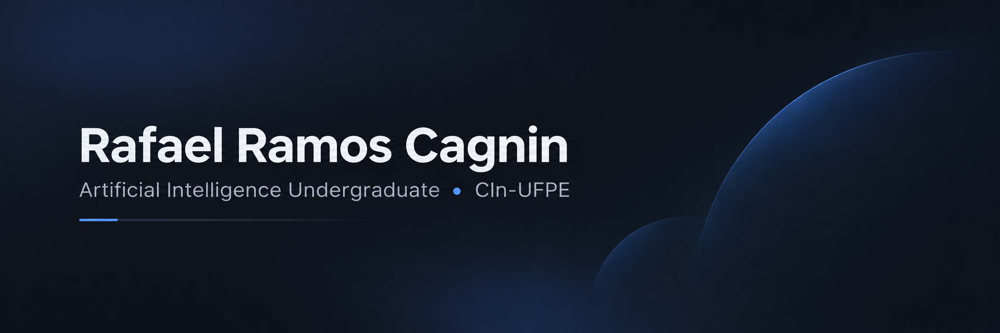

 

 

&nbsp;

  

📍 Recife, Brazil &nbsp; | &nbsp; 🎓 Federal University of Pernambuco

---

## 👨‍💻 About Me

I'm an **Artificial Intelligence undergraduate at the Federal University of Pernambuco (UFPE)**, studying at the **Centro de Informática (CIn)**.

I'm interested in building practical technology solutions, particularly in **Artificial Intelligence, Data Science, and Software Engineering**.

- 🎓 Pursuing my Bachelor's degree in **Artificial Intelligence at CIn-UFPE**.
- 👨‍🏫 **Teaching Assistant** for Introduction to Artificial Intelligence.
- 💻 Developing my programming skills in **Python and C++**.
- 🧠 Exploring **Machine Learning, Data Science, and Applied AI**.
- 🚀 Learning through academic activities and collaborative software development.
- 🎯 Focused on strengthening my technical foundations and gaining professional experience in technology.

---

## 🛠️ Tech Stack

### 💻 Programming Languages

  

### 🤖 AI & Data Science

  

**Currently exploring:** Machine Learning, RAG, data analysis and predictive modeling.

### ⚙️ Development Tools

  

My stack includes technologies used in academic activities and tools I'm currently learning.

---

## 🌱 What I'm Exploring

| Area | Current Focus |
| :--- | :--- |
| 🤖 **Artificial Intelligence** | Machine Learning, Applied AI, RAG |
| 📊 **Data Science** | Data Analysis, Data Preprocessing, Predictive Modeling |
| 💻 **Computer Science** | Data Structures, Algorithms, Object-Oriented Programming |
| ⚙️ **Software Engineering** | APIs, Version Control, Collaborative Development |

I'm focused on combining a strong foundation in computer science with practical experience to build meaningful technology solutions.

---

## 🤝 Let's Connect!

I'm always open to learning, collaborating, and connecting with people who share an interest in technology and Artificial Intelligence.

&nbsp;

  

*Always learning. Always building. Always improving.* 🚀

